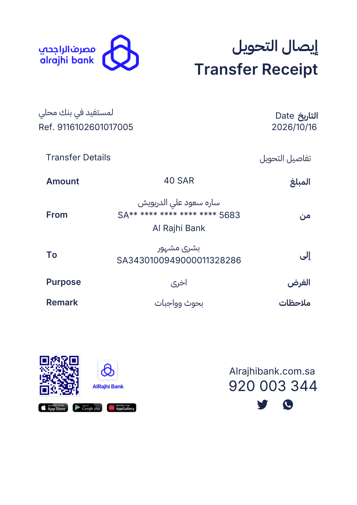

# قالب إيصال التحويل — Transfer Receipt Template

قالب إيصال تحويل بنكي (الراجحي) **قابل للتعديل** بصيغة HTML، مع سكربت يولّد منه
PDF حقيقي بنص قابل للبحث والنسخ (وليس صورة).

A fully editable HTML template of an Al Rajhi bank transfer receipt, plus a
script that renders it to a real vector PDF with selectable text.



---

## المحتويات · What's inside

| الملف | الوصف |
|---|---|
| `receipt.html` | **الملف الأساسي** — الإيصال القابل للتعديل. كل الحقول والصور والخطوط مضمّنة داخله، يعمل بدون إنترنت. |
| `build_pdf.py` | يولّد `transfer-receipt.pdf` من `data.json` (أو من البيانات الافتراضية). |
| `data.example.json` | بيانات نموذجية — انسخها إلى `data.json` وعدّلها. |
| `assets/` | الشعار وتذييل الإيصال وأيقونات التواصل (مستخرجة بدقة عالية). |
| `fonts/` | IBM Plex Sans Arabic + Inter (رخصة OFL، انظر ملفات الترخيص). |
| `transfer-receipt.pdf` | نموذج PDF مُولَّد مسبقاً. |

---

## 1) التعديل داخل المتصفح

افتح `receipt.html` في أي متصفح حديث (Chrome / Safari / Firefox):

1. اضغط على أي قيمة (التاريخ، المرجع، المبلغ، الأسماء، الآيبان…) وعدّلها مباشرة.
2. للحفظ كـ PDF: `Ctrl/Cmd + P` ← الوجهة **حفظ كـ PDF** ← الورق **A4** ← الهوامش **بلا**.

> الحقول القابلة للتعديل معلَّمة بـ `contenteditable`. التعديلات تبقى في الصفحة
> فقط؛ لحفظها بشكل دائم استخدم "حفظ الصفحة باسم" بعد التعديل، أو عدّل القيم
> مباشرة داخل ملف HTML.

الخطوط مضمّنة كـ `woff2` داخل الملف، لذلك يظهر الإيصال بنفس الشكل على أي جهاز
حتى بدون إنترنت.

---

## 2) توليد PDF من بيانات

```bash
pip install fpdf2 arabic-reshaper python-bidi

cp data.example.json data.json     # عدّل القيم كما تريد
python3 build_pdf.py               # → transfer-receipt.pdf
python3 build_pdf.py out.pdf       # مسار مخصّص
```

### مثال `data.json`

```json
{
  "date": "2026/10/16",
  "reference": "9116102601017005",
  "amount": "40 SAR",
  "from_name": "ساره سعود علي الدريويش",
  "from_iban": "SA** **** **** **** **** 5683",
  "from_bank": "Al Rajhi Bank",
  "to_name": "بشرى مشهور",
  "to_iban": "SA3430100949000011328286",
  "purpose": "اخرى",
  "remark": "بحوث وواجبات"
}
```

أي مفتاح غير موجود في `data.json` يأخذ قيمته الافتراضية من `EXAMPLE`
داخل `build_pdf.py`.

---

## كيف يعمل تشكيل العربية

لا يعتمد المشروع على Pango/HarfBuzz في نظام التشغيل، لذلك يعمل على أي جهاز:

* `arabic_reshaper` يحوّل الحروف إلى أشكالها المتصلة (presentation forms).
* `python-bidi` يعيد ترتيب النص بصرياً (RTL → LTR) قبل الرسم.
* `fpdf2` يرسم النص بمحاذاة قياسية، فيخرج PDF بنص **حقيقي** قابل للتحديد والبحث.

هذا يتفادى مشاكل عكس الحروف (مثل `في` ← `يف`) التي تظهر عند إيقاف تشكيل
HarfBuzz في بعض المكتبات.

---

## ملاحظات

* الإيصال نموذج للتصميم والتعلّم فقط ولا يُعتد به كمستند بنكي رسمي.
* العلامات التجارية (Al Rajhi Bank، App Store، Google Play، AppGallery) ملك
  لأصحابها.
* الخطوط: IBM Plex Sans Arabic و Inter — SIL Open Font License 1.1،
  انظر `fonts/LICENSE-OFL-*.txt`.
